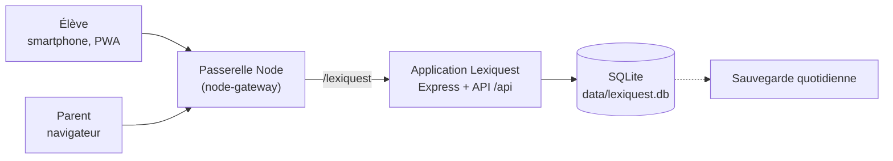

# Lexiquest — cahier des charges

*Version 2 du projet « Carnet de Vocabulaire » : un jeu pédagogique pour mémoriser le vocabulaire de néerlandais et d'anglais, avec comptes, données centralisées sur serveur, statistiques pour l'élève et suivi parent.*

Maquette interactive : [`maquette/index.html`](../maquette/index.html) (à ouvrir dans un navigateur ; rôles élève et parent, absence simulée, deux styles complets : Jeu et Adulte ; l'application garde le style Adulte).

## 1. Contexte et objectifs

La v1 était un artefact autonome : listes et progression dans le navigateur d'un seul appareil, sans compte, sans suivi. Lexiquest en fait une application web installable, hébergée sur le serveur du parent, où réviser devient un jeu à jouer chaque jour.

- **Ludique** : épreuves courtes, mascotte réactive, compagnon fantastique à soigner.
- **Séances de 5 minutes** : un jeu, une séance, environ 5 minutes.
- **Variété imposée** : on ne peut pas rejouer le même jeu en boucle (rotation, §4.3).
- **Un Gardien par semaine** à vaincre pour sauver le compagnon (§4.4).
- **Gemmes** : monnaie gagnée en réussissant les exercices, plus abondante dans les jeux difficiles.
- **Une seule langue par séance** : néerlandais et anglais ne se mélangent jamais.
- **Retour quotidien encouragé** : bons de régularité et compagnon dont les jauges baissent heure par heure si l'on ne revient pas.
- **Comptes et centralisation** : listes, séances et résultats stockés sur le serveur.
- **Statistiques** pour l'élève et suivi détaillé pour le parent : quand, combien de temps, quels résultats, quelles difficultés.
- **Smartphone first**, design moderne et fluide.

Hors périmètre : classes et enseignants, classement entre élèves, achats réels, intelligence artificielle générative, comptes ouverts au public.

## 2. Décisions de conception

| Décision | Raison |
| --- | --- |
| Aucun déblocage par niveau ; tous les jeux sont accessibles au départ | Laisser l'élève choisir ce qui lui plaît |
| Un jeu se verrouille s'il est trop rejoué, et se retrouve en jouant d'autres jeux | Forcer la variété sans interdire personne |
| Un Gardien à vaincre chaque semaine, sinon le compagnon souffre | Une échéance hebdomadaire qui ramène aux épreuves les plus exigeantes |
| Les gemmes ne s'obtiennent qu'en réussissant, davantage dans les jeux difficiles | Récompenser l'effort réel |
| Les gemmes ne servent qu'au compagnon (soins, nourriture, nouveaux compagnons) | Une seule économie, simple à équilibrer |
| Le compagnon ne meurt jamais | Il décrépit visiblement ; à 0 de vie, il est « à terre » et une potion de résurrection le relève : pression réelle, jamais de perte définitive |
| Un seul compagnon actif | Les autres se reposent et ne décrépissent pas |
| Une séance = une seule langue | Éviter toute confusion entre néerlandais et anglais |

## 3. Utilisateurs et droits

| Action | Élève | Parent (admin) |
| --- | --- | --- |
| Se connecter (identifiant + mot de passe) | Oui | Oui |
| Créer et modifier ses listes de mots | Oui | Oui, sur toutes les listes |
| Assigner une liste à un élève | Non | Oui |
| Jouer, dépenser ses gemmes | Oui | Aperçu sans enregistrer de résultats |
| Voir ses propres statistiques et son compagnon | Oui | Oui |
| Voir l'historique détaillé des séances et des erreurs | Non | Oui |
| Régler objectif, tolérance de correction | Non | Oui |
| Créer, désactiver, réinitialiser un compte | Non | Oui |
| Exporter ou supprimer les données d'un élève | Non | Oui |

Un parent au départ, plusieurs élèves possibles ; un élève n'accède jamais aux données d'un autre.

**Deux entrées distinctes** : l'écran de connexion de l'élève est celui d'un jeu, sans bouton ni mention « parent ». Le rôle découle du compte ; le parent se connecte avec son compte à une adresse à part (`/lexiquest/parent`), jamais proposée dans l'interface de l'élève. Le vocabulaire côté élève reste celui du jeu (pas de « contrôle parental » ni de « surveillance » mis en avant).

**Transparence** : l'élève voit ses propres statistiques et sait que son parent peut les consulter, avec le détail des séances ; la mention est discrète et formulée simplement.

## 4. Parcours de jeu

### 4.1 Choisir la langue puis quoi réviser

1. **Langue** : néerlandais ou anglais, choix obligatoire et visible (couleur et pastille propres à chaque langue).
2. **Portée**, toujours dans la langue choisie :

| Portée | Contenu |
| --- | --- |
| Toutes mes listes | Toutes les listes de la langue |
| Une liste | Une liste précise de la langue |
| Ma sélection | Plusieurs listes de la langue, cochées |
| Mots à revoir | Mots difficiles de la langue, détectés sur 30 jours |

3. **Jeu**, puis **sens** (langue → français ou français → langue).

**Jamais de mélange de langues** : une séance, un QCM, un gardien ou un tirage de mots ne contiennent que la langue choisie ; les mauvaises réponses proposées en QCM viennent de la même langue ; l'écran de séance porte en permanence un bandeau de la langue (nom, pastille, couleur).

Le tirage favorise les mots les moins maîtrisés, puis mélange.

### 4.2 Les cinq jeux

| Jeu | Principe | Mots | Gemmes par bon mot | Difficulté |
| --- | --- | --- | --- | --- |
| Chasse aux cartes | Carte retournable, glissée à droite (je savais) ou à gauche (à revoir) | 14 | 1 | ●○○○○ |
| Duel des sages | QCM à 4 choix, combos | 14 | 2 | ●●○○○ |
| Lettres folles | Anagramme : remettre les lettres dans l'ordre | 9 | 3 | ●●●○○ |
| La Forge | Écrire le mot de mémoire ; un indice coûte 1 gemme | 9 | 4 | ●●●●○ |
| Le Gardien | Boss : 3 cœurs, QCM (2) et écriture (4) alternés, 8 coups pour le vaincre | 12 | 2 à 4 | ●●●●● |

Un mot raté est re-présenté une fois dans la séance (sauf contre le Gardien) ; raté deux fois, il est abandonné pour cette séance et reste dans « Mots à revoir ». Lettres folles, La Forge et Le Gardien demandent d'écrire dans la langue étudiée ; les autres laissent choisir le sens. Le nombre de mots est calibré pour viser 5 minutes.

### 4.3 Rotation des jeux

- Chaque jeu hors Gardien se **verrouille après 3 séances** jouées depuis son dernier déblocage.
- Il se **déverrouille** quand l'élève termine des séances de **2 autres jeux différents** (le Gardien compte).
- Les compteurs persistent d'un jour à l'autre ; le Gardien n'est jamais verrouillé.
- L'écran de jeu montre pour chaque jeu : parties restantes avant verrouillage, ou « verrouillé, joue encore N autres jeux (x/2) ».
- Paramètres (3 et 2) en configuration serveur.

### 4.4 Le Gardien de la semaine

- Chaque semaine (du lundi au dimanche), l'élève doit **vaincre au moins un Gardien** pour sauver son compagnon.
- **L'élève choisit la langue** du Gardien, avec une règle : jamais la même langue **3 semaines de suite**. Si les deux semaines précédentes ont été validées dans la même langue, l'autre langue est imposée pour la semaine courante.
- Une fois la semaine validée, d'autres Gardiens restent jouables dans n'importe quelle langue : c'est un **Gardien bonus**. Victoire ou défaite, il n'a **aucun effet** : ni sur le compagnon, ni sur la règle des langues, ni bonus de 20 gemmes ; seules les gemmes des bonnes réponses et de fin de séance comptent.
- **Si aucun Gardien n'est vaincu** au passage du lundi : le compagnon perd 40 de vie et 20 de plaisir (« Le Gardien a frappé »).
- Le premier Gardien vaincu de la semaine rapporte 20 gemmes de bonus, plus l'état « sauvé » sur l'accueil.
- L'accueil affiche le Gardien de la semaine avec les jours restants ; il devient urgent le dernier jour.

## 5. Économie de gemmes

**Gains**

| Événement | Gemmes |
| --- | --- |
| Bonne réponse du premier coup | valeur du jeu (1 à 4), +1 avec un combo d'au moins 3 |
| Bonne réponse avec indice, ou au second essai | moitié de la valeur du jeu, arrondie au-dessus |
| Séance terminée | +5 (+2 si le Gardien résiste) |
| Séance sans faute (hors Gardien) | +10 |
| Gardien de la semaine vaincu (pas un Gardien bonus) | +20 |
| Bon du jour (première séance du jour) | +10 |
| Bons de régularité | 3 jours +15 · 7 jours +40 · 14 jours +100 · 30 jours +250 |

Une séance moyenne (75 % de réussite du premier coup, +5 de fin compris) rapporte environ 23 gemmes en Chasse aux cartes, 35 en Duel, 33 en Lettres folles, 40 en La Forge ; 50 à 67 sans faute. Avec la rotation, une séance vaut environ **33 gemmes** (valeurs à calibrer à l'usage, barème en configuration serveur).

**Boutique**

| Article | Prix (gemmes) | Effet |
| --- | --- | --- |
| Pomme dorée | 20 | +25 énergie |
| Gâteau au miel | 36 | +50 énergie |
| Grand festin | 70 | +100 énergie, +10 plaisir |
| Potion de soin | 40 | +35 vie |
| Bain moussant | 30 | +20 vie, +5 plaisir |
| Balle magique | 20 | +25 plaisir |
| Potion de résurrection | 150 | Seulement si le compagnon est à terre : vie, énergie et plaisir à 50 |

**Achats durables** (gardés pour toujours, valables pour tous les compagnons ; un accessoire et un décor portés à la fois, qu'on change librement) :

| Article | Prix (gemmes) | Effet |
| --- | --- | --- |
| **Accessoires** (16), dessinés sur le compagnon | | |
| Fleur des champs | 50 | Sur la tête |
| Nœud papillon | 60 | Au cou |
| Collier de perles | 80 | Au cou |
| Écharpe | 90 | Au cou |
| Bonnet à pompon | 100 | Sur la tête |
| Casquette | 110 | Sur la tête |
| Lunettes rondes | 120 | Sur les yeux |
| Lunettes de soleil | 130 | Sur les yeux |
| Bandeau de pirate | 140 | Sur un œil |
| Médaille d'or | 160 | Au cou |
| Chapeau de magicien | 180 | Sur la tête |
| Auréole | 250 | Au-dessus de la tête |
| Couronne dorée | 300 | Sur la tête |
| Casque audio | 160 | Sur la tête |
| Monocle | 190 | Sur un œil |
| Cape de héros | 220 | Au cou |
| **Décors** (15), fond de la carte du compagnon | | |
| Prairie fleurie | 100 | Ciel bleu, herbe et fleurs |
| Mer de nuages | 120 | Aube rose, nuages blancs |
| Forêt enchantée | 150 | Dégradé vert |
| Désert doré | 160 | Soleil, dunes |
| Montagne enneigée | 180 | Sommet sur ciel clair |
| Verger d'automne | 200 | Feuilles orange et rouges |
| Plage | 220 | Ciel et sable |
| Fond marin | 260 | Bleu profond, bulles |
| Château | 320 | Violet et pierre |
| Volcan | 340 | Ciel rouge, cône sombre |
| Aurore boréale | 400 | Voiles vert et violet sur ciel nocturne |
| Ciel étoilé | 450 | Nuit et étoiles |
| Village sous la neige | 240 | Flocons, sol blanc |
| Jungle | 280 | Feuillage vert |
| Espace | 520 | Étoiles, planètes |

Purement décoratifs : aucun effet sur les jauges.

**Compagnons** : Lexi le phénix (offert), Pyro le dragonnet (400), Étoile la licorne (700), Griff le griffon (1 000), Glouglou le bébé kraken (1 500), Roussette le renardeau (1 200), Hulotte la chouette (1 800).

**Équilibre visé : une séance par jour, plus le bon du jour, suffit tout juste à garder le compagnon en vie.** Le but est d'inciter à faire plusieurs séances par jour.

| | Gemmes par jour |
| --- | --- |
| Revenu : 1 séance (≈ 33) + bon du jour (10) | ≈ 43 (33 si la séance est faible) |
| Entretien : plaisir −27 (≈ 1,1 balle, 22) + énergie −22 (≈ 0,45 gâteau, 16) + usure de la vie par les événements (≈ 2) | ≈ 40 |
| Bonus réguliers : Gardien de la semaine (+20 par semaine) et bons de série (405 sur le premier mois) | ≈ 3, et ≈ 13 le premier mois |

Avec une seule séance, il ne reste presque rien à épargner. Chaque séance de plus rapporte environ 33 gemmes nettes : Pyro en 12 jours environ à deux séances par jour, une couronne en 9 jours. Tous les compagnons et articles (≈ 8 300 gemmes : 3 600 de compagnons, 1 770 d'accessoires, 2 900 de décors) représentent plus d'une année scolaire à deux séances par jour, un semestre à trois : il reste toujours un objectif d'épargne, avec des petits prix (50 à 120) atteignables en quelques jours.

## 6. Compagnon (inspiration Tamagotchi)

- Trois jauges de 0 à 100 : **vie**, **énergie** (nourriture), **plaisir** (amusement).
- **Baisse heure par heure**, jouée ou non, **nuit comprise**. La nuit (de 20 h à 8 h), le compagnon dort : toutes les baisses sont **divisées par deux**.

| Jauge | Jour (8 h – 20 h) | Nuit (20 h – 8 h) | Sur 24 h | Remède |
| --- | --- | --- | --- | --- |
| Plaisir | −1,5 par heure | −0,75 par heure | −27 | Balle magique, bain, festin |
| Énergie | −1,2 par heure | −0,6 par heure | ≈ −22 | Pomme, gâteau, festin |
| Vie | −0,75 par heure **tant que l'énergie est sous 20** (faim), et autant **tant que le plaisir est sous 20** (ennui) | moitié | jusqu'à −27 | Potion de soin, bain |

La vie n'a pas de baisse propre ; elle perd en plus 40 pour chaque semaine sans Gardien vaincu (au passage du lundi).

- **Événement aléatoire** tous les 1 à 3 jours (intervalle tiré entre 24 et 72 h, à toute heure), parmi **30 événements**, chacun sur une seule jauge. 15 favorables, 15 défavorables, 10 par jauge. Le dernier s'affiche sous les jauges (« Il y a 5 h : Lexi a trouvé des baies sauvages, +15 énergie ») et dans le suivi parent.

| Jauge | Favorables | Défavorables |
| --- | --- | --- |
| Énergie | baies sauvages +15, ruche abandonnée pleine de miel +20, noisettes partagées par un écureuil +10, pommes tombées avec le vent +15, grande sieste au soleil +10 | orage qui empêche de dormir −15, goûter volé par un corbeau −10, matinée à courir après un papillon −10, cauchemar −10, gelée qui abîme les fruits −15 |
| Plaisir | jeu avec une luciole +15, double arc-en-ciel +10, visite d'un lutin farceur +20, plume brillante +10, étoile filante +15 | journée de pluie −15, jouet perdu dans la mare −10, moqueries d'un troll grincheux −15, coincé dans le brouillard −10, cache-cache perdu contre un lapin −5 |
| Vie | source magique +10, aile soignée par une fée +15, nuit sur un lit de mousse +10, tisane d'une gentille sorcière +10, herbe médicinale +5 | rhume −10, buisson de ronces −10, chute d'un arbre −15, piqûre de guêpe −5, champignon douteux −10 |
- **À terre** : quand la vie atteint 0, le compagnon tombe (gris, couché, « zzz »). Ses jauges sont figées (plus de baisse ni d'événement), les autres articles de la boutique sont refusés et on ne peut pas changer de compagnon actif. Seule la **potion de résurrection** (150 gemmes, environ 4 séances) le relève, à 50 dans les trois jauges. C'est volontairement coûteux : laisser tomber son compagnon doit se sentir.
- Ordre de grandeur : sans soin, le plaisir passe sous 20 en 2 à 3 jours, l'énergie aussi ; après 4 jours d'absence, le compagnon est décrépit, et à terre avant 7 jours.
- Entre 20 h et 8 h, la bulle du compagnon en forme dit qu'il somnole.
- Cinq états : **radieux** (moyenne 65 et plus), **content** (45 à 64), **fatigué** (25 à 44), **décrépit** (moins de 25), **à terre** (vie à 0, prioritaire).
- Rendu : radieux = couleurs vives, animé ; fatigué = désaturé, paupières lourdes ; décrépit = gris, poussière, toiles d'araignée, yeux ternes ; à terre = entièrement gris, penché, immobile, « zzz ».
- Le compagnon exprime son besoin le plus urgent dans une bulle.
- Stades de croissance selon les jours de présence : bébé (0 à 6), jeune (7 à 20), adulte (21 et plus).
- Il ne meurt jamais définitivement ; la potion de résurrection le relève. Le parent voit son état et le dernier événement.

## 7. Régularité

- **Série** : jours consécutifs avec au moins une séance terminée.
- **Bon du jour** : +10 gemmes à la première séance de la journée.
- **Bons de palier** : 3, 7, 14 et 30 jours de suite ; chaque bon s'encaisse une fois par série, une série brisée les réinitialise.
- Aucune pénalité en gemmes : la seule conséquence d'une absence est la décrépitude du compagnon.
- **Rappel quotidien** par notification sur le téléphone (§16 bis).

## 8. Fonctionnalités côté élève

| ID | Fonction | Critère d'acceptation | Lot |
| --- | --- | --- | --- |
| E1 | Connexion | Session de 30 jours ; aucune entrée « parent » sur l'écran élève | 1 |
| E2 | Accueil | Compagnon et état, Gardien de la semaine, série, bons, bouton « Jouer » | 1 |
| E3 | Choix langue puis portée | Langue obligatoire ; listes et mots à revoir filtrés par langue ; durée estimée | 1 |
| E4 | Cinq jeux | Une langue par séance ; ≈ 5 min ; gemmes par jeu affichées | 1 |
| E5 | Rotation des jeux | Verrouillage après 3 séances, déblocage par 2 autres jeux, état visible | 1 |
| E6 | Gardien hebdomadaire | Statut et jours restants ; pénalité au passage du lundi si non vaincu ; Gardien bonus sans effet | 1 |
| E7 | Récap de séance | Gemmes détaillées, durée active, mots ratés, jeux verrouillés ou retrouvés | 1 |
| E8 | Boutique, soins, compagnons | Acheter, adopter, choisir le compagnon actif ; jauges horaires, événements aléatoires, résurrection ; accessoires et décors achetés, portés ou retirés | 1 |
| E9 | Mes mots | Listes par langue, création par collage « mot = traduction », maîtrise par mot | 1 |
| E10 | Mes stats | Jours joués, temps, réussite, jeux utilisés, maîtrise par langue, calendrier, mots coriaces | 1 |
| E11 | Régularité | Bon du jour, bons de palier, série | 2 |
| E12 | Hors-ligne et installation | Séance sans réseau ; ajout à l'écran d'accueil (§16) | 2 |
| E13 | Rappel quotidien | Notification à l'heure choisie, seulement si l'élève n'a pas joué (§16 bis) | 3 |
| E14 | Import de listes | Collage « mot = traduction » ou fichier CSV (deux colonnes séparées par `;` ou tabulation) | 3 |

## 9. Statistiques et suivi parent

L'élève et le parent partagent les mêmes indicateurs ; le parent y ajoute le détail des séances.

| Écran | Contenu | Élève | Parent |
| --- | --- | --- | --- |
| Aperçu / Mes stats | Jours joués sur 7, temps, réussite et évolution, série, minutes par jour, réussite par semaine, calendrier de 8 semaines (couleur selon les minutes du jour : 0, moins de 3, 3 à 5, 6 à 9, 10 et plus) | Oui | Oui |
| Jeux et langues | Séances par jeu sur 30 jours, maîtrise par langue, Gardiens vaincus | Oui | Oui |
| Mots difficiles | Mots les plus ratés avec essais et taux d'échec ; filtre par langue | Oui | Oui, avec dernière erreur |
| Séances | Liste filtrable, détail réponse par réponse (mot, réponse donnée, juste ou non, temps, type d'erreur), langue de chaque séance | Non | Oui |
| Alertes et compagnon | Absence de 2 jours ou plus, compagnon fatigué, décrépit ou à terre, dernier événement, Gardien non vaincu, objectif de jours | Non | Oui |
| Réglages | Jours de jeu par semaine, tolérance accents et articles, listes assignées, comptes, export CSV | Non | Oui |

## 10. Définitions des indicateurs

| Indicateur | Définition |
| --- | --- |
| Séance | De l'ouverture d'un jeu à sa fin ; elle porte une seule langue ; sans réponse, elle n'est pas conservée |
| Temps actif | Application au premier plan avec interaction récente (pulsation toutes les 15 s, pause de plus de 45 s non comptée) |
| Taux de réussite | Réponses justes au premier essai divisées par les mots présentés |
| Mot maîtrisé | Trois bonnes réponses de suite ; une faute remet la série à zéro |
| Mot difficile | Au moins 3 essais sur 30 jours et un taux d'échec d'au moins 40 % |
| Type d'erreur | « Presque » à 2 lettres ou moins du mot attendu, sinon « oubli » |
| Jour joué | Jour avec au moins une séance terminée |
| Semaine | Du lundi au dimanche |
| Jeu verrouillé | Jeu dont le compteur a atteint 3 et qui attend 2 autres jeux différents |
| État du compagnon | Moyenne des trois jauges après simulation heure par heure (baisses, faim, ennui, événements, pénalités de Gardien) ; « à terre » si la vie est à 0 |

## 11. Design et expérience

- **Smartphone first** : 390 px de large, une main ; tableau de bord parent en deux colonnes dès 900 px.
- **Navigation élève** : barre d'onglets en bas (Accueil, Jouer, Avatar, Stats, Mots) ; rail latéral sur grand écran.
- **Deux langues, deux identités** : ambre et pastille NL, bleu et pastille EN, bandeau de langue en séance, jamais d'écran qui mélange les deux.
- **Ton** : pensé pour une adolescente, jamais infantilisant, rien qui évoque un outil de contrôle.
- **Fluidité** : transitions de 150 à 250 ms, mouvement réduit si demandé par le système ; thèmes clair et sombre ; contraste AA ; cibles tactiles de 48 px au moins ; polices hébergées sur le serveur.

**Style retenu : « Adulte »** (décision du parent). Sobre : fonds gris clair ou graphite, filets fins, une seule teinte dorée, jauges minces, Plus Jakarta Sans ; le compagnon dans un halo discret. Le style « Jeu » (contours épais, couleurs vives) n'est pas repris dans l'application ; il reste visible dans la maquette. Le thème clair ou sombre se règle sur l'appareil (Auto, Clair, Sombre).

## 12. Architecture technique

**Contraintes de la passerelle** (dépôt `Gatomlo/node-gateway`, hébergement Infomaniak : une seule application Node par hébergement) :

- L'application exporte son app Express (`module.exports = app`) et n'appelle `listen()` que si `require.main === module`.
- Elle est montée sur `/lexiquest` : côté navigateur, **aucun chemin absolu** ; la base est déduite à l'exécution (comme `BASE` dans Répétito).
- Cookie de session : `Path` = base, `HttpOnly`, `Secure`, `SameSite=Lax`.
- Code déposé dans `apps/lexiquest` de la passerelle ; base SQLite dans un dossier `data/` hors dépôt, sauvegardé.
- **Aucune variable d'environnement obligatoire**, comme les autres outils : secret de session et clés VAPID générés au premier démarrage et gardés en base (table `kv`) ; le premier compte, le compte parent, se crée à la première visite de `/lexiquest/parent` (`POST /api/setup`, refusé dès qu'un compte existe) ; le parent ajoute ensuite l'élève. Un script serveur (`scripts/reset-password.js`) règle le cas du mot de passe oublié.
- L'outil n'a rien à installer ; au démarrage, il répare un `node_modules` abîmé s'il en a un et recharge ses modules si Node refuse un `package.json` sur le volume réseau. Le manifeste s'appelle `manifest.json` pour que la page d'accueil de la passerelle en affiche l'icône.

**Socle** : Node.js 22.5 ou plus (`node:sqlite`, à vérifier chez l'hébergeur), JavaScript vanilla sans build, comme Fée Lezcomptes. **Aucune dépendance propre** (l'installation sur l'hébergeur a déjà été corrompue par des coupures) : Express est celui de la passerelle ; mots de passe scrypt, sessions signées HMAC en base et Web Push (VAPID + chiffrement aes128gcm) écrits avec `node:crypto`.

## 13. Modèle de données

| Table | Champs clés | Rôle |
| --- | --- | --- |
| `users` | id, identifiant, nom affiché, rôle, hash, actif | Comptes |
| `lists` | id, propriétaire, **langue**, nom, assignée par, version | Listes (une langue chacune) |
| `words` | id, liste, terme, traduction, position | Paires de mots |
| `sessions` | id, élève, **langue**, portée, jeu, sens, début, fin, temps actif, mots, bonnes réponses, victoire, identifiant client | Une ligne par séance (l'identifiant client rend l'import hors-ligne idempotent) |
| `answers` | id, séance, mot, essai, réponse donnée, juste, type d'erreur, temps (ms), horodatage | Événements en ajout seul |
| `word_stats` | élève, mot, essais, échecs, série, dernière réponse | Cache recalculable |
| `http_sessions` | identifiant, contenu, expiration | Sessions de connexion (30 jours, survivent aux redémarrages) |
| `gem_events` | id, élève, delta, motif, séance, date | Registre des gemmes ; solde = somme |
| `user_pets` | élève, espèce, vie, énergie, plaisir, heure de référence, actif, adopté le | Compagnons |
| `push_subs` | point d'accès, utilisateur, clés | Appareils abonnés aux notifications |
| `kv` | clé, valeur | Clés VAPID, dernier rappel envoyé |
| `user_items` | élève, article, catégorie (accessoire, décor), acheté le, porté | Achats durables |
| `pet_events` | id, élève, compagnon, heure, type (événement aléatoire, Gardien, résurrection), jauge, delta | Journal du compagnon (écrit quand les jauges sont figées) |
| *(sans table)* | rotation, Gardien hebdomadaire, série, minutes par jour | Recalculés depuis `sessions` à chaque lecture : jamais de désaccord possible |
| `vouchers` | élève, palier, série, encaissé le | Bons encaissés |
| `settings` | élève ou global, clé, valeur | Barème, rotation, objectifs, tolérance |

Règles non évidentes :

- La décrépitude se calcule à la lecture : le serveur rejoue heure par heure depuis l'heure de référence (baisses de jour et de nuit, faim, ennui, pénalité du lundi, événements), arrête la simulation à 0 de vie, puis fige le résultat et l'heure de référence à chaque achat ou séance. Pas de tâche planifiée.
- Les événements aléatoires sont tirés d'un générateur pseudo-aléatoire initialisé par élève : la même heure donne toujours le même événement, quel que soit le moment de la lecture.
- Les gemmes sont calculées **côté serveur** à partir des événements reçus ; le client affiche de façon optimiste.
- Le serveur refuse une séance contenant des mots de deux langues et un jeu verrouillé.
- Le catalogue des compagnons et de la boutique est en configuration, pas en base.
- Les réponses d'un mot supprimé sont conservées avec une copie du terme.

## 14. API REST (sous `/lexiquest/api`)

| Route | Rôle | Accès |
| --- | --- | --- |
| `POST /auth/login`, `POST /auth/logout`, `GET /me` | Session et profil | Tous |
| `GET/POST /lists`, `GET/PUT/DELETE /lists/:id` | Listes et mots | Élève, parent |
| `GET /games` | Jeux, compteurs et verrouillages | Élève |
| `POST /sessions` (langue, portée, jeu, sens), `POST /sessions/:id/events`, `POST /sessions/:id/end` | Séance par lots ; renvoie gemmes, verrouillages, bons | Élève |
| `POST /sessions/import` | Séance jouée hors-ligne (identifiant unique, mots, réponses, heure) ; corrigée et valorisée comme une séance en ligne | Élève |
| `GET /push/key`, `POST /push/subscribe`, `POST /push/unsubscribe`, `POST /push/test`, `GET/PUT /reminder`, `POST /cron/reminders` | Notifications et rappel (heure, activation) ; le cron exige `x-cron-key` | Élève, parent |
| `GET /weekly-boss` | Statut du Gardien de la semaine et langue interdite éventuelle | Élève |
| `GET /wallet`, `GET /shop`, `POST /shop/buy`, `POST /shop/equip` | Solde, catalogue, achat, porter ou retirer un accessoire ou un décor | Élève |
| `GET /pets`, `POST /pets/:id/adopt`, `POST /pets/:id/activate` | Compagnons, jauges à l'heure, dernier événement ; activation refusée si l'actif est à terre | Élève |
| `GET /streak`, `POST /vouchers/:palier/claim` | Régularité et bons | Élève |
| `GET /stats`, `GET /review-queue?lang=` | Statistiques de l'élève, mots à revoir | Élève |
| `GET /admin/students`, `GET /admin/students/:id/overview`, `.../sessions?range=`, `.../sessions/:sid`, `.../difficulties`, `.../settings`, `.../lists`, `.../export.csv` | Suivi (le calendrier est dans `overview`) | Parent |
| `POST /admin/students`, `PATCH /admin/students/:id` (réglages, mot de passe), `POST /admin/students/:id/lists`, `DELETE /admin/students/:id/lists/:lid`, `DELETE /admin/students/:id` | Comptes, réglages, listes données | Parent |

## 15. Sécurité, vie privée, sauvegardes

Les résultats scolaires d'une mineure sont des données sensibles : collecte minimale, hébergement chez le parent, aucun tiers.

- Mots de passe hachés avec scrypt (sel aléatoire) ; blocage temporaire après 10 échecs en 15 minutes (par identifiant et adresse).
- Cloisonnement côté serveur par identifiant ; routes `/admin` réservées au parent.
- Pas d'e-mail obligatoire, pas de statistiques tierces, pas de polices ni scripts externes.
- Journal des connexions, créations de comptes, exports, suppressions.
- Copie quotidienne de la base, conservée 30 jours, restauration testée.
- Export CSV et suppression complète à la demande du parent.
- Dépôt GitHub public : aucune donnée réelle d'élève, ni `.env`, ni `*.db`.

## 16. Hors-ligne et synchronisation

- **Application installable** : manifeste (`manifest.json`, `manifest-parent.json`), icônes, service worker versionné par l'empreinte des fichiers (un changement du site renouvelle le cache). Réseau d'abord avec repli sur le cache ; `/api` jamais intercepté ni mis en cache.
- **Jouer sans réseau** : après une première connexion, l'appareil garde le dernier état (listes, compagnon, rotation, Gardien) et le barème. Hors-ligne, il choisit les mots avec les mêmes règles que le serveur (une langue, rotation, langue interdite du Gardien), fait jouer la séance et la range dans une file locale avec un identifiant unique. Une séance commencée en ligne et coupée en route suit le même chemin.
- **Synchronisation** : au retour du réseau (et toutes les minutes tant que la file n'est pas vide), les séances partent de la plus ancienne à la plus récente vers `POST /sessions/import`. Le serveur **corrige et recalcule tout** (réponses, gemmes, bon du jour du jour réel de la séance, rotation, série) ; il ignore un identifiant déjà reçu ; l'heure de début est ramenée dans les 14 derniers jours et jamais dans le futur ; une séance refusée (mots inconnus, séance incomplète) est abandonnée.
- **Hors-ligne, les gemmes affichées sont une estimation** (bandeau « séance gardée sur ton appareil ») ; la boutique, les bons et la connexion demandent le réseau.
- Une déconnexion vide le dernier état mis en cache mais garde les séances en attente.

## 16 bis. Notifications

- **Web Push** (clés VAPID, générées au premier démarrage ou fournies par `VAPID_PUBLIC_KEY` / `VAPID_PRIVATE_KEY`, contact `VAPID_SUBJECT`). Android : directement ; iPhone : seulement après « Sur l'écran d'accueil » (iOS 16.4 ou plus).
- **Élève** : un rappel par jour à l'heure choisie (17 h 30 par défaut), **seulement si elle n'a pas encore joué ce jour-là**. Message selon la situation : compagnon à terre, dernier jour du Gardien, compagnon fatigué, sinon invitation simple.
- **Parent** : un message par jour à l'heure choisie (19 h par défaut) si l'élève n'a pas joué depuis 2 jours ou plus.
- Un rappel manqué (serveur arrêté) part avec 2 h de retard au plus, puis est abandonné. Un appareil qui ne répond plus (404, 410) est désabonné.
- **Déclenchement** : une minuterie dans le processus Node (désactivable par `REMINDERS=off`) ; si l'hébergeur n'a pas de processus permanent, un cron externe appelle `POST /api/cron/reminders` avec l'en-tête `x-cron-key` (variable `CRON_KEY`).

## 17. Plan de livraison

| Lot | Contenu | Porte de validation |
| --- | --- | --- |
| 0 — Socle | Dépôt, comptes, session, SQLite, montage sur la passerelle, HTTPS | Connexion fonctionnelle sur le domaine |
| 1 — Jeu | Langue et portée, cinq jeux, rotation, Gardien hebdomadaire, gemmes, boutique, compagnons, stats élève, suivi parent | Une semaine d'usage réel, chiffres cohérents |
| 2 — Régularité et confort | Bons, décrépitude complète, hors-ligne, PWA, calendrier, export | Hors-ligne testé en mode avion |
| 3 — Extras | Rappels par notification, import CSV, nouveaux compagnons et articles (l'e-mail hebdomadaire est abandonné) | Notification reçue sur le téléphone |

Critères d'acceptation du lot 1 :

- [ ] L'élève se connecte sur son smartphone et retrouve listes, gemmes et compagnon après avoir fermé l'application.
- [ ] Impossible de lancer une séance sans choisir une langue ; aucun mot de l'autre langue n'apparaît, en QCM comme ailleurs.
- [ ] Les listes se choisissent par langue : une liste, plusieurs listes ou toutes les listes de la langue.
- [ ] Après 3 séances du même jeu, il est verrouillé ; il se rouvre après 2 séances de 2 autres jeux différents.
- [ ] Le Gardien de la semaine s'affiche avec ses jours restants ; sans victoire, le compagnon perd 40 de vie au lundi ; un Gardien bonus ne change rien.
- [ ] Le plaisir baisse chaque heure, l'énergie aussi, deux fois moins vite de 20 h à 8 h ; la vie baisse quand l'énergie ou le plaisir est sous 20 ; un événement aléatoire (parmi 30) survient tous les 1 à 3 jours.
- [ ] À 0 de vie, le compagnon est à terre et seule la potion de résurrection le relève.
- [ ] La langue du Gardien est au choix, mais après deux semaines de suite dans la même langue, la troisième impose l'autre.
- [ ] Les gemmes correspondent au barème et un jeu difficile rapporte plus qu'un jeu facile.
- [ ] Une séance dure en moyenne 5 minutes (4 à 6) avec le nombre de mots prévu.
- [ ] L'élève consulte ses statistiques ; le parent voit les mêmes chiffres plus le détail des séances.
- [ ] Un élève ne peut lire ni les données d'un autre élève ni les routes `/admin`.
- [ ] Tous les écrans restent utilisables sans zoom sur 360 px de large.
- [ ] Une sauvegarde est restaurée avec succès sur un environnement de test.

## 18. Points à valider

- [x] **Thème visuel** : style « Adulte » retenu.
- [ ] **Rotation** : 3 séances avant verrouillage et 2 autres jeux pour le rouvrir, trop ou trop peu ?
- [ ] **Gardien** : langue au choix mais jamais 3 semaines de suite la même, pénalité de 40 de vie et 20 de plaisir, adaptées ?
- [ ] **Jauges et prix** : −1,5 plaisir et −1,2 énergie par heure, −0,75 vie par heure et par jauge sous 20, nuit (20 h – 8 h) à mi-vitesse, résurrection à 150 gemmes : une séance par jour suffit-elle *tout juste* en usage réel ?
- [ ] **Barème** : gemmes par jeu (1 à 4), bonus et prix des compagnons, à calibrer après une semaine d'usage.
- [ ] **Compagnons** : tous décroissent ou seul l'actif ? (recommandé : seul l'actif)
- [ ] **Hébergement** : version de Node chez Infomaniak (`node:sqlite` demande 22.5 ou plus), emplacement persistant de `data/`.
- [ ] **Domaine** : sous-domaine dédié ou chemin `/lexiquest` de la passerelle.
- [ ] **Durée** : le parent peut-il ajuster le nombre de mots par séance ?
- [ ] **Correction en écriture** : articles `de` et `het` obligatoires, accents tolérés ?
- [ ] **Import des listes** : collage de texte suffisant, ou CSV et photo plus tard ?
