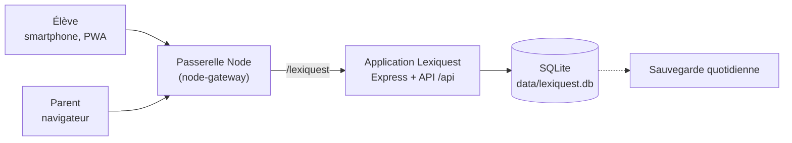

# Lexiquest — cahier des charges

*Version 2 du projet « Carnet de Vocabulaire » : un jeu pédagogique pour mémoriser le vocabulaire de néerlandais et d'anglais, avec comptes, données centralisées sur serveur et suivi parent.*

Maquette interactive : [`maquette/index.html`](../maquette/index.html) (à ouvrir dans un navigateur, mode smartphone ou ordinateur, rôles élève et parent).

## 1. Contexte et objectifs

La v1 était un artefact autonome : listes et progression dans le navigateur d'un seul appareil, sans compte, sans suivi. Lexiquest en fait une application web installable, hébergée sur le serveur du parent, où réviser devient un jeu à jouer chaque jour.

Objectifs :

- **Ludique** : épreuves courtes, mascotte réactive, compagnon fantastique à soigner.
- **Séances de 5 minutes** : un jeu, une séance, environ 5 minutes.
- **Tous les jeux ouverts** dès le premier jour : aucun niveau à atteindre pour débloquer.
- **Retour quotidien encouragé** : bons de régularité et compagnon qui dépérit si l'on ne revient pas.
- **Comptes et centralisation** : listes, séances et résultats stockés sur le serveur.
- **Suivi parent** : quand l'élève a travaillé, combien de temps, avec quels résultats, sur quels mots il bloque.
- **Smartphone first**, design moderne et fluide.

Hors périmètre : classes et enseignants, classement entre élèves, achats réels, intelligence artificielle générative, comptes ouverts au public.

## 2. Décisions de conception

| Décision | Raison |
| --- | --- |
| Aucun déblocage par niveau ; tous les jeux sont accessibles | Laisser l'élève choisir ce qui lui plaît ; la motivation vient du compagnon et des points, pas de verrous |
| Une séance ≈ 5 minutes | Format tenable chaque jour, compatible avec un objectif quotidien réaliste |
| Les points ne s'obtiennent qu'en réussissant des exercices | Le soin du compagnon dépend du travail réel |
| Les points ne servent qu'au compagnon (soins, nourriture, nouveaux compagnons) | Une seule économie, simple à comprendre et à équilibrer |
| Le compagnon **ne meurt jamais** | Il décrépit visiblement mais un soin le rétablit : pression douce, jamais de perte définitive pour un adolescent |
| Un seul compagnon actif à la fois | Les autres se reposent et ne décrépissent pas : pas de culpabilité multipliée |

## 3. Utilisateurs et droits

| Action | Élève | Parent (admin) |
| --- | --- | --- |
| Se connecter (identifiant + mot de passe) | Oui | Oui |
| Créer et modifier ses listes de mots | Oui | Oui, sur toutes les listes |
| Assigner une liste à un élève | Non | Oui |
| Jouer, dépenser ses points | Oui | Aperçu sans enregistrer de résultats |
| Voir sa progression et son compagnon | Oui | Oui |
| Voir l'historique détaillé des séances et des erreurs | Non | Oui |
| Régler objectif, tolérance de correction | Non | Oui |
| Créer, désactiver, réinitialiser un compte | Non | Oui |
| Exporter ou supprimer les données d'un élève | Non | Oui |

Un parent au départ, plusieurs élèves possibles. Un élève n'accède jamais aux données d'un autre.

**Deux entrées distinctes** : l'écran de connexion de l'élève est celui d'un jeu, sans bouton ni mention « parent ». Le rôle découle du compte ; le parent se connecte avec son compte à une adresse à part (`/lexiquest/parent`), jamais proposée dans l'interface de l'élève. Le vocabulaire côté élève reste celui du jeu (pas de « contrôle parental », « surveillance », « suivi par ton parent » en avant).

**Transparence** : l'élève sait ce que le parent peut consulter (jours, durée, résultats, mots difficiles) via une mention discrète dans son profil et dans le récap de séance, formulée simplement et sans insistance.

## 4. Parcours de jeu

### 4.1 Choisir quoi réviser

| Portée | Contenu |
| --- | --- |
| Toutes les listes | Tous les mots de toutes les listes |
| Une liste | Une liste précise |
| Ma sélection | Plusieurs listes cochées |
| Mots à revoir | Mots difficiles détectés sur 30 jours |

Dans tous les cas, le tirage favorise les mots les moins maîtrisés, puis mélange.

### 4.2 Les cinq jeux

| Jeu | Principe | Mots par séance |
| --- | --- | --- |
| Chasse aux cartes | Carte retournable, glissée à droite (je savais) ou à gauche (à revoir) | 14 |
| Duel des sages | QCM à 4 choix, combos sur les séries de bonnes réponses | 14 |
| Lettres folles | Anagramme : remettre les lettres dans l'ordre | 9 |
| La Forge | Écrire le mot de mémoire ; un indice coûte 1 point | 9 |
| Le Gardien | Boss : 3 cœurs, QCM et écriture alternés, 8 coups pour le vaincre | 12 |

Règles communes : un mot raté est re-présenté une fois dans la séance (sauf contre le Gardien) ; le sens (langue → français, français → langue) se choisit, sauf pour Lettres folles, La Forge et Le Gardien qui demandent d'écrire dans la langue étudiée. Le nombre de mots par jeu est calibré pour viser 5 minutes.

## 5. Économie de points

**Gains**

| Événement | Points |
| --- | --- |
| Bonne réponse du premier coup | +2 (+3 avec un combo d'au moins 3 ; +1 si un indice est utilisé) |
| Bonne réponse au second essai | +1 |
| Séance terminée | +5 (+2 si le Gardien résiste) |
| Séance sans faute | +10 |
| Gardien vaincu | +15 |
| Bon du jour (première séance du jour) | +10 |
| Bons de régularité | 3 jours +15 · 7 jours +40 · 14 jours +100 · 30 jours +250 |

Une séance typique rapporte 25 à 40 points (valeurs à calibrer à l'usage, stockées en configuration serveur).

**Boutique**

| Article | Prix | Effet |
| --- | --- | --- |
| Pomme dorée | 5 | +25 faim |
| Gâteau au miel | 12 | +50 faim |
| Grand festin | 25 | +100 faim, +10 humeur |
| Potion de soin | 8 | +35 forme |
| Bain moussant | 6 | +20 forme, +5 humeur |
| Balle magique | 4 | +25 humeur |

**Compagnons** : Lexi le phénix (offert), Pyro le dragonnet (150), Étoile la licorne (220), Griff le griffon (300), Glouglou le bébé kraken (400).

Équilibre visé : l'entretien quotidien coûte environ 15 points, ce qui laisse 15 à 25 points par jour à épargner ; un nouveau compagnon s'obtient en une à trois semaines, plus vite avec les bons de régularité.

## 6. Compagnon (inspiration Tamagotchi)

- Trois jauges de 0 à 100 : **faim**, **forme**, **humeur**.
- Décroissance chaque jour, jouée ou non : −15 faim, −8 forme, −12 humeur. Seuls les points dépensés en soins les remontent.
- Quatre états selon la moyenne des jauges : **radieux** (65 et plus), **content** (45 à 64), **fatigué** (25 à 44), **décrépit** (moins de 25).
- Rendu visuel : radieux = couleurs vives et animé ; fatigué = désaturé, paupières lourdes ; décrépit = gris, poussière, toiles d'araignée, yeux ternes.
- Le compagnon exprime son besoin le plus urgent dans une bulle (« J'ai faim… »).
- Stades de croissance selon les jours de présence (jour avec séance ou soin) : bébé (0 à 6), jeune (7 à 20), adulte (21 et plus), avec davantage d'ornements.
- Le compagnon ne meurt jamais ; un soin suffit à le rétablir.
- Le parent voit l'état du compagnon dans son tableau de bord.

## 7. Régularité

- **Série** : jours consécutifs avec au moins une séance terminée.
- **Bon du jour** : +10 points à la première séance de la journée.
- **Bons de palier** : 3, 7, 14 et 30 jours de suite ; chaque bon s'encaisse une fois par série, une série brisée les réinitialise.
- **Semaine visuelle** : 7 pastilles, jour courant entouré.
- Aucune pénalité en points : la seule conséquence d'une absence est la décrépitude du compagnon.
- Lot 3 : rappel quotidien par notification à l'heure choisie.

## 8. Fonctionnalités côté élève

| ID | Fonction | Critère d'acceptation | Lot |
| --- | --- | --- | --- |
| E1 | Connexion | Identifiant + mot de passe, session de 30 jours sur l'appareil, déconnexion en un geste ; aucune entrée « parent » sur l'écran élève | 1 |
| E2 | Accueil | Compagnon et son état, série, bons, bouton « Jouer une séance » | 1 |
| E3 | Choix de la portée | Toutes les listes, une liste, une sélection, mots à revoir ; durée estimée affichée | 1 |
| E4 | Cinq jeux | Tous accessibles dès le départ ; une séance dure environ 5 minutes | 1 |
| E5 | Récap de séance | Points détaillés, durée active, mots ratés, rejouer les mots ratés | 1 |
| E6 | Boutique et soins | Acheter nourriture, soins, jeux ; effet visible immédiatement sur les jauges | 1 |
| E7 | Compagnons | Adopter, choisir le compagnon actif | 1 |
| E8 | Mes mots | Listes par langue, création et import par collage « mot = traduction », maîtrise par mot | 1 |
| E9 | Régularité | Bon du jour, bons de palier, série | 2 |
| E10 | Décrépitude complète | États visuels du compagnon, messages, alertes d'accueil | 2 |
| E11 | Hors-ligne | Séance possible sans réseau, synchronisation au retour de la connexion | 2 |
| E12 | Installation | Ajout à l'écran d'accueil, plein écran, icône dédiée | 2 |
| E13 | Rappel quotidien | Notification à l'heure choisie si aucune séance du jour | 3 |

## 9. Suivi parent

| Écran | Contenu | Question |
| --- | --- | --- |
| Aperçu | Dernière séance (date, heure, durée, jeu, liste), jours joués sur 7, temps, réussite et évolution, série, alertes, état du compagnon, minutes par jour, réussite par semaine, calendrier de 8 semaines, heures habituelles | A-t-il travaillé, quand, combien ? |
| Séances | Liste filtrable par période ; détail réponse par réponse (mot, réponse donnée, juste ou non, temps, type d'erreur) | Que s'est-il passé ? |
| Difficultés | Mots les plus ratés avec essais, taux d'échec, dernière erreur, réponse fausse fréquente ; filtre par langue | Où bloque-t-il ? |
| Réglages | Jours de jeu par semaine, tolérance accents et articles, listes assignées, comptes, export CSV | Comment paramétrer ? |

Alertes : aucune séance depuis 2 jours ou plus, compagnon fatigué ou décrépit, objectif de jours non atteint, mot raté plus de 5 fois sans réussite récente.

## 10. Définitions des indicateurs

| Indicateur | Définition |
| --- | --- |
| Séance | De l'ouverture d'un jeu à sa fin ou son abandon ; une séance sans réponse n'est pas conservée |
| Temps actif | Intervalles où l'application est au premier plan avec une interaction récente (pulsation toutes les 15 s, pause de plus de 45 s non comptée) |
| Réponse | Un mot présenté une fois : jeu, sens, réponse donnée, juste ou non, temps en ms, horodatage |
| Taux de réussite | Réponses justes au premier essai divisées par les mots présentés, sur la période |
| Mot maîtrisé | Trois bonnes réponses de suite ; une faute remet la série à zéro |
| Mot difficile | Au moins 3 essais sur 30 jours et un taux d'échec d'au moins 40 % |
| Type d'erreur | « Presque » si la réponse est à 2 lettres ou moins du mot attendu, sinon « oubli » |
| Jour joué | Jour avec au moins une séance terminée |
| État du compagnon | Moyenne des trois jauges, après décroissance des jours écoulés depuis la dernière mise à jour |

## 11. Design et expérience

- **Smartphone first** : référence 390 px de large, une main ; tableau de bord parent en deux colonnes à partir de 900 px.
- **Ambiance de jeu** : style « autocollant » (contours épais, ombres dures, boutons qui s'enfoncent), couleurs vives, mascotte réactive, confettis, rebonds et secousses ; ambre pour le néerlandais, bleu pour l'anglais.
- **Ton** : conçu pour une adolescente, jamais infantilisant ni scolaire ; humour léger, messages courts, rien qui évoque un outil de contrôle.
- **Typographie** : Lilita One pour les titres et chiffres, Nunito pour le texte, 16 px minimum.
- **Navigation** : barre d'onglets en bas (Accueil, Jouer, Avatar, Mots) ; rail latéral sur grand écran.
- **Fluidité** : transitions de 150 à 250 ms, mouvement réduit si l'option système est activée.
- **Thèmes** : clair et sombre selon le système.
- **Accessibilité** : contraste AA, information jamais portée par la couleur seule, cibles tactiles d'au moins 48 px.
- **Installable** : PWA, ouverture en moins de 2 s sur 4G après la première visite. Polices hébergées sur le serveur.

## 12. Architecture technique

**Contraintes de la passerelle** (dépôt `Gatomlo/node-gateway`, hébergement Infomaniak : une seule application Node par hébergement) :

- L'application exporte son app Express (`module.exports = app`) et n'appelle `listen()` que si `require.main === module`.
- Elle est montée sur `/lexiquest` : côté navigateur, **aucun chemin absolu** (`/api/...`, `/app.js`) ; la base est déduite à l'exécution comme dans Répétito (`BASE`).
- Le cookie de session porte `Path` = base, `HttpOnly`, `Secure`, `SameSite=Lax`.
- Le code est déposé dans `apps/lexiquest` de la passerelle (SFTP ou Git) ; la base SQLite vit dans un dossier `data/` hors dépôt, sauvegardé.

**Socle** : Node.js 22.5 ou plus (`node:sqlite`, à vérifier chez l'hébergeur, sinon `better-sqlite3`), Express, express-session, bcryptjs, JavaScript vanilla sans étape de build — le même que Fée Lezcomptes.

## 13. Modèle de données

| Table | Champs clés | Rôle |
| --- | --- | --- |
| `users` | id, identifiant, nom affiché, rôle, hash du mot de passe, actif | Comptes |
| `lists` | id, propriétaire, langue, nom, assignée par, version | Listes de mots |
| `words` | id, liste, terme, traduction, position | Paires de mots |
| `sessions` | id, élève, portée, jeu, sens, début, fin, temps actif, mots, bonnes réponses | Une ligne par séance |
| `answers` | id, séance, mot, essai, réponse donnée, juste, type d'erreur, temps (ms), horodatage | Événements en ajout seul |
| `word_stats` | élève, mot, essais, échecs, série, dernière réponse | Cache recalculable |
| `daily_activity` | élève, jour, temps actif, séances, réponses | Cache recalculable |
| `point_events` | id, élève, delta, motif, séance, date | Registre des points ; solde = somme |
| `user_pets` | élève, espèce, faim, forme, humeur, jour de référence, actif, adopté le | État des compagnons |
| `vouchers` | élève, palier, série, encaissé le | Bons de régularité encaissés |
| `settings` | élève ou global, clé, valeur | Barème, objectifs, tolérance |

Règles non évidentes :

- La décrépitude n'est pas une tâche planifiée : l'état se calcule à la lecture à partir du jour de référence de chaque jauge et de la décroissance par jour.
- Les points sont calculés **côté serveur** à partir des événements reçus (le client affiche de façon optimiste) ; le solde est la somme de `point_events`.
- Le catalogue des compagnons et de la boutique est en configuration, pas en base.
- Les réponses d'un mot supprimé sont conservées avec une copie du terme.

## 14. API REST (sous `/lexiquest/api`)

| Route | Rôle | Accès |
| --- | --- | --- |
| `POST /auth/login`, `POST /auth/logout`, `GET /me` | Session et profil | Tous |
| `GET/POST /lists`, `GET/PUT/DELETE /lists/:id` | Listes et mots | Élève, parent |
| `POST /sessions`, `POST /sessions/:id/events`, `POST /sessions/:id/end` | Ouvrir, alimenter par lots, clôturer ; renvoie points et bons | Élève |
| `GET /wallet`, `GET /shop` | Solde, catalogue | Élève |
| `POST /shop/buy` | Acheter un article pour le compagnon actif | Élève |
| `GET /pets`, `POST /pets/:id/adopt`, `POST /pets/:id/activate` | Compagnons | Élève |
| `GET /streak`, `POST /vouchers/:palier/claim` | Régularité et bons | Élève |
| `GET /review-queue` | Mots à revoir | Élève |
| `GET /admin/students`, `GET /admin/students/:id/overview?range=` | Vue d'ensemble | Parent |
| `GET /admin/students/:id/sessions`, `.../sessions/:sid` | Historique et détail | Parent |
| `GET /admin/students/:id/difficulties`, `.../calendar` | Mots difficiles, calendrier | Parent |
| `POST /admin/students`, `PATCH /admin/students/:id` | Comptes et réglages | Parent |
| `POST /admin/lists/:id/assign` | Assigner une liste | Parent |
| `GET /admin/students/:id/export.csv` | Export | Parent |

## 15. Sécurité, vie privée, sauvegardes

Les résultats scolaires d'une mineure sont des données sensibles : collecte minimale, hébergement chez le parent, aucun tiers.

- Mots de passe hachés avec bcrypt ; blocage temporaire après 5 échecs de connexion.
- Cloisonnement côté serveur par identifiant d'utilisateur ; routes `/admin` réservées au parent.
- Pas d'e-mail obligatoire, pas de statistiques tierces, pas de polices ni de scripts externes.
- Journal des connexions, créations de comptes, exports et suppressions.
- Copie quotidienne du fichier SQLite, conservée 30 jours, restauration testée avant mise en production.
- Export CSV et suppression complète à la demande du parent.
- `.env` et fichiers `*.db` jamais versionnés. Le dépôt GitHub étant public, il ne contient aucune donnée réelle d'élève.

## 16. Hors-ligne et synchronisation

- Interface en réseau d'abord avec repli sur le cache ; `/api` jamais intercepté.
- Listes en copie locale (IndexedDB) ; modification hors-ligne envoyée au retour du réseau, dernière modification gagnante.
- Séances et réponses placées dans une file locale avec UUID, envoyées par lots toutes les 15 s et au retour du réseau ; le serveur ignore un UUID déjà reçu.
- Le serveur plafonne la durée d'une réponse à 60 s et refuse les horodatages futurs.
- Déconnexion refusée tant que la file contient des événements non envoyés.

## 17. Plan de livraison

| Lot | Contenu | Porte de validation |
| --- | --- | --- |
| 0 — Socle | Dépôt, comptes, session, base SQLite, montage sur la passerelle, déploiement HTTPS | Connexion fonctionnelle sur le domaine |
| 1 — Jeu | Listes, portée, cinq jeux, séances de 5 min, points, boutique, compagnons, suivi parent de base | Une semaine d'usage réel avec des chiffres cohérents |
| 2 — Régularité et confort | Bons, décrépitude complète, hors-ligne, PWA, calendrier, export | Hors-ligne testé en mode avion |
| 3 — Extras | Rappels, e-mail hebdomadaire, import CSV, nouveaux compagnons et articles | — |

Critères d'acceptation du lot 1 :

- [ ] L'élève se connecte sur son smartphone et retrouve listes, points et compagnon après avoir fermé l'application.
- [ ] Il peut lancer chacun des cinq jeux sur une liste, plusieurs listes ou toutes les listes, sans condition de niveau.
- [ ] Une séance dure en moyenne 5 minutes (4 à 6) avec le nombre de mots prévu.
- [ ] Les points gagnés correspondent au barème et le solde diminue à l'achat.
- [ ] Une séance apparaît dans le suivi parent : date, heure, durée active, jeu, portée, score, réponses.
- [ ] Un mot raté au moins 3 fois sur 30 jours (40 % d'échec) apparaît dans les difficultés.
- [ ] Un élève ne peut lire ni les données d'un autre élève ni les routes `/admin`.
- [ ] Tous les écrans restent utilisables sans zoom sur 360 px de large.
- [ ] Une sauvegarde est restaurée avec succès sur un environnement de test.

## 18. Points à valider

- [ ] **Hébergement** : version de Node disponible chez Infomaniak (`node:sqlite` demande 22.5 ou plus), emplacement persistant du dossier `data/`.
- [ ] **Passerelle** : l'application peut-elle gérer sa propre session derrière `node-gateway` ? (oui, comme Fée Lezcomptes)
- [ ] **Domaine** : sous-domaine dédié ou chemin `/lexiquest` de la passerelle.
- [ ] **Décrépitude** : rythme de décroissance (−15, −8, −12 par jour) et seuils d'état adaptés ?
- [ ] **Compagnons** : tous décroissent ou seul l'actif ? (recommandé : seul l'actif)
- [ ] **Barème** : points par séance et prix des compagnons, à calibrer après une semaine d'usage.
- [ ] **Durée** : le parent peut-il ajuster le nombre de mots par séance ?
- [ ] **Alertes** : récapitulatif hebdomadaire par e-mail et rappel quotidien souhaités ? (lot 3)
- [ ] **Correction en écriture** : articles `de` et `het` obligatoires, accents tolérés ?
- [ ] **Import des listes** : collage de texte suffisant, ou CSV et photo du cahier plus tard ?
