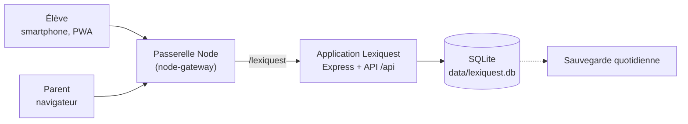

# Lexiquest — cahier des charges

*Version 2 du projet « Carnet de Vocabulaire » : un jeu pédagogique pour mémoriser le vocabulaire de néerlandais et d'anglais, avec comptes, données centralisées sur serveur, statistiques pour l'élève et suivi parent.*

Maquette interactive : [`maquette/index.html`](../maquette/index.html) (à ouvrir dans un navigateur ; rôles élève et parent, absence simulée, deux styles d'accueil).

## 1. Contexte et objectifs

La v1 était un artefact autonome : listes et progression dans le navigateur d'un seul appareil, sans compte, sans suivi. Lexiquest en fait une application web installable, hébergée sur le serveur du parent, où réviser devient un jeu à jouer chaque jour.

- **Ludique** : épreuves courtes, mascotte réactive, compagnon fantastique à soigner.
- **Séances de 5 minutes** : un jeu, une séance, environ 5 minutes.
- **Variété imposée** : on ne peut pas rejouer le même jeu en boucle (rotation, §4.3).
- **Un Gardien par semaine** à vaincre pour sauver le compagnon (§4.4).
- **Gemmes** : monnaie gagnée en réussissant les exercices, plus abondante dans les jeux difficiles.
- **Une seule langue par séance** : néerlandais et anglais ne se mélangent jamais.
- **Retour quotidien encouragé** : bons de régularité et compagnon qui dépérit si l'on ne revient pas.
- **Comptes et centralisation** : listes, séances et résultats stockés sur le serveur.
- **Statistiques** pour l'élève et suivi détaillé pour le parent : quand, combien de temps, quels résultats, quelles difficultés.
- **Smartphone first**, design moderne et fluide.

Hors périmètre : classes et enseignants, classement entre élèves, achats réels, intelligence artificielle générative, comptes ouverts au public.

## 2. Décisions de conception

| Décision | Raison |
| --- | --- |
| Aucun déblocage par niveau ; tous les jeux sont accessibles au départ | Laisser l'élève choisir ce qui lui plaît |
| Un jeu se verrouille s'il est trop rejoué, et se retrouve en jouant d'autres jeux | Forcer la variété sans interdire personne |
| Un Gardien à vaincre chaque semaine, sinon le compagnon souffre | Une échéance hebdomadaire qui ramène aux épreuves les plus exigeantes |
| Les gemmes ne s'obtiennent qu'en réussissant, davantage dans les jeux difficiles | Récompenser l'effort réel |
| Les gemmes ne servent qu'au compagnon (soins, nourriture, nouveaux compagnons) | Une seule économie, simple à équilibrer |
| Le compagnon ne meurt jamais | Il décrépit visiblement ; un soin le rétablit : pression douce, jamais de perte définitive |
| Un seul compagnon actif | Les autres se reposent et ne décrépissent pas |
| Une séance = une seule langue | Éviter toute confusion entre néerlandais et anglais |

## 3. Utilisateurs et droits

| Action | Élève | Parent (admin) |
| --- | --- | --- |
| Se connecter (identifiant + mot de passe) | Oui | Oui |
| Créer et modifier ses listes de mots | Oui | Oui, sur toutes les listes |
| Assigner une liste à un élève | Non | Oui |
| Jouer, dépenser ses gemmes | Oui | Aperçu sans enregistrer de résultats |
| Voir ses propres statistiques et son compagnon | Oui | Oui |
| Voir l'historique détaillé des séances et des erreurs | Non | Oui |
| Régler objectif, tolérance de correction | Non | Oui |
| Créer, désactiver, réinitialiser un compte | Non | Oui |
| Exporter ou supprimer les données d'un élève | Non | Oui |

Un parent au départ, plusieurs élèves possibles ; un élève n'accède jamais aux données d'un autre.

**Deux entrées distinctes** : l'écran de connexion de l'élève est celui d'un jeu, sans bouton ni mention « parent ». Le rôle découle du compte ; le parent se connecte avec son compte à une adresse à part (`/lexiquest/parent`), jamais proposée dans l'interface de l'élève. Le vocabulaire côté élève reste celui du jeu (pas de « contrôle parental » ni de « surveillance » mis en avant).

**Transparence** : l'élève voit ses propres statistiques et sait que son parent peut les consulter, avec le détail des séances ; la mention est discrète et formulée simplement.

## 4. Parcours de jeu

### 4.1 Choisir la langue puis quoi réviser

1. **Langue** : néerlandais ou anglais, choix obligatoire et visible (couleur et pastille propres à chaque langue).
2. **Portée**, toujours dans la langue choisie :

| Portée | Contenu |
| --- | --- |
| Toutes mes listes | Toutes les listes de la langue |
| Une liste | Une liste précise de la langue |
| Ma sélection | Plusieurs listes de la langue, cochées |
| Mots à revoir | Mots difficiles de la langue, détectés sur 30 jours |

3. **Jeu**, puis **sens** (langue → français ou français → langue).

**Jamais de mélange de langues** : une séance, un QCM, un gardien ou un tirage de mots ne contiennent que la langue choisie ; les mauvaises réponses proposées en QCM viennent de la même langue ; l'écran de séance porte en permanence un bandeau de la langue (nom, pastille, couleur).

Le tirage favorise les mots les moins maîtrisés, puis mélange.

### 4.2 Les cinq jeux

| Jeu | Principe | Mots | Gemmes par bon mot | Difficulté |
| --- | --- | --- | --- | --- |
| Chasse aux cartes | Carte retournable, glissée à droite (je savais) ou à gauche (à revoir) | 14 | 1 | ●○○○○ |
| Duel des sages | QCM à 4 choix, combos | 14 | 2 | ●●○○○ |
| Lettres folles | Anagramme : remettre les lettres dans l'ordre | 9 | 3 | ●●●○○ |
| La Forge | Écrire le mot de mémoire ; un indice coûte 1 gemme | 9 | 4 | ●●●●○ |
| Le Gardien | Boss : 3 cœurs, QCM (2) et écriture (4) alternés, 8 coups pour le vaincre | 12 | 2 à 4 | ●●●●● |

Un mot raté est re-présenté une fois dans la séance (sauf contre le Gardien). Lettres folles, La Forge et Le Gardien demandent d'écrire dans la langue étudiée ; les autres laissent choisir le sens. Le nombre de mots est calibré pour viser 5 minutes.

### 4.3 Rotation des jeux

- Chaque jeu hors Gardien se **verrouille après 3 séances** jouées depuis son dernier déblocage.
- Il se **déverrouille** quand l'élève termine des séances de **2 autres jeux différents** (le Gardien compte).
- Les compteurs persistent d'un jour à l'autre ; le Gardien n'est jamais verrouillé.
- L'écran de jeu montre pour chaque jeu : parties restantes avant verrouillage, ou « verrouillé, joue encore N autres jeux (x/2) ».
- Paramètres (3 et 2) en configuration serveur.

### 4.4 Le Gardien de la semaine

- Chaque semaine (du lundi au dimanche), l'élève doit **vaincre au moins un Gardien** pour sauver son compagnon.
- La langue du Gardien proposé alterne d'une semaine à l'autre (néerlandais, puis anglais) pour couvrir les deux langues ; n'importe quel Gardien vaincu valide la semaine.
- **Si aucun Gardien n'est vaincu** au passage du lundi : le compagnon perd 40 de forme et 20 d'humeur (« Le Gardien a frappé »).
- Un Gardien vaincu rapporte 20 gemmes de bonus, plus l'état « sauvé » sur l'accueil.
- L'accueil affiche le Gardien de la semaine avec les jours restants ; il devient urgent le dernier jour.

## 5. Économie de gemmes

**Gains**

| Événement | Gemmes |
| --- | --- |
| Bonne réponse du premier coup | valeur du jeu (1 à 4), +1 avec un combo d'au moins 3 |
| Bonne réponse avec indice, ou au second essai | moitié de la valeur du jeu, arrondie au-dessus |
| Séance terminée | +5 (+2 si le Gardien résiste) |
| Séance sans faute (hors Gardien) | +10 |
| Gardien vaincu | +20 |
| Bon du jour (première séance du jour) | +10 |
| Bons de régularité | 3 jours +15 · 7 jours +40 · 14 jours +100 · 30 jours +250 |

Une séance rapporte environ 20 gemmes en Chasse aux cartes, 35 en Duel, 40 en Lettres folles, 50 en La Forge, davantage avec les bonus (valeurs à calibrer à l'usage, barème en configuration serveur).

**Boutique**

| Article | Prix (gemmes) | Effet |
| --- | --- | --- |
| Pomme dorée | 5 | +25 faim |
| Gâteau au miel | 12 | +50 faim |
| Grand festin | 25 | +100 faim, +10 humeur |
| Potion de soin | 8 | +35 forme |
| Bain moussant | 6 | +20 forme, +5 humeur |
| Balle magique | 4 | +25 humeur |

**Compagnons** : Lexi le phénix (offert), Pyro le dragonnet (150), Étoile la licorne (220), Griff le griffon (300), Glouglou le bébé kraken (400).

Équilibre visé : l'entretien quotidien coûte environ 15 gemmes ; le reste s'épargne pour de nouveaux compagnons.

## 6. Compagnon (inspiration Tamagotchi)

- Trois jauges de 0 à 100 : **faim**, **forme**, **humeur**.
- Décroissance chaque jour, jouée ou non : −15 faim, −8 forme, −12 humeur ; −40 forme et −20 humeur pour chaque semaine sans Gardien vaincu. Seules les gemmes dépensées en soins les remontent.
- Quatre états selon la moyenne : **radieux** (65 et plus), **content** (45 à 64), **fatigué** (25 à 44), **décrépit** (moins de 25).
- Rendu : radieux = couleurs vives, animé ; fatigué = désaturé, paupières lourdes ; décrépit = gris, poussière, toiles d'araignée, yeux ternes.
- Le compagnon exprime son besoin le plus urgent dans une bulle.
- Stades de croissance selon les jours de présence : bébé (0 à 6), jeune (7 à 20), adulte (21 et plus).
- Il ne meurt jamais ; un soin suffit à le rétablir. Le parent voit son état.

## 7. Régularité

- **Série** : jours consécutifs avec au moins une séance terminée.
- **Bon du jour** : +10 gemmes à la première séance de la journée.
- **Bons de palier** : 3, 7, 14 et 30 jours de suite ; chaque bon s'encaisse une fois par série, une série brisée les réinitialise.
- Aucune pénalité en gemmes : la seule conséquence d'une absence est la décrépitude du compagnon.
- Lot 3 : rappel quotidien par notification.

## 8. Fonctionnalités côté élève

| ID | Fonction | Critère d'acceptation | Lot |
| --- | --- | --- | --- |
| E1 | Connexion | Session de 30 jours ; aucune entrée « parent » sur l'écran élève | 1 |
| E2 | Accueil | Compagnon et état, Gardien de la semaine, série, bons, bouton « Jouer » | 1 |
| E3 | Choix langue puis portée | Langue obligatoire ; listes et mots à revoir filtrés par langue ; durée estimée | 1 |
| E4 | Cinq jeux | Une langue par séance ; ≈ 5 min ; gemmes par jeu affichées | 1 |
| E5 | Rotation des jeux | Verrouillage après 3 séances, déblocage par 2 autres jeux, état visible | 1 |
| E6 | Gardien hebdomadaire | Statut et jours restants ; pénalité au passage du lundi si non vaincu | 1 |
| E7 | Récap de séance | Gemmes détaillées, durée active, mots ratés, jeux verrouillés ou retrouvés | 1 |
| E8 | Boutique, soins, compagnons | Acheter, adopter, choisir le compagnon actif | 1 |
| E9 | Mes mots | Listes par langue, création par collage « mot = traduction », maîtrise par mot | 1 |
| E10 | Mes stats | Jours joués, temps, réussite, jeux utilisés, maîtrise par langue, calendrier, mots coriaces | 1 |
| E11 | Régularité | Bon du jour, bons de palier, série | 2 |
| E12 | Hors-ligne et installation | Séance sans réseau ; ajout à l'écran d'accueil | 2 |
| E13 | Rappel quotidien | Notification à l'heure choisie | 3 |

## 9. Statistiques et suivi parent

L'élève et le parent partagent les mêmes indicateurs ; le parent y ajoute le détail des séances.

| Écran | Contenu | Élève | Parent |
| --- | --- | --- | --- |
| Aperçu / Mes stats | Jours joués sur 7, temps, réussite et évolution, série, minutes par jour, réussite par semaine, calendrier de 8 semaines | Oui | Oui |
| Jeux et langues | Séances par jeu sur 30 jours, maîtrise par langue, Gardiens vaincus | Oui | Oui |
| Mots difficiles | Mots les plus ratés avec essais et taux d'échec ; filtre par langue | Oui | Oui, avec dernière erreur |
| Séances | Liste filtrable, détail réponse par réponse (mot, réponse donnée, juste ou non, temps, type d'erreur), langue de chaque séance | Non | Oui |
| Alertes et compagnon | Absence de 2 jours ou plus, compagnon fatigué ou décrépit, Gardien non vaincu, objectif de jours | Non | Oui |
| Réglages | Jours de jeu par semaine, tolérance accents et articles, listes assignées, comptes, export CSV | Non | Oui |

## 10. Définitions des indicateurs

| Indicateur | Définition |
| --- | --- |
| Séance | De l'ouverture d'un jeu à sa fin ; elle porte une seule langue ; sans réponse, elle n'est pas conservée |
| Temps actif | Application au premier plan avec interaction récente (pulsation toutes les 15 s, pause de plus de 45 s non comptée) |
| Taux de réussite | Réponses justes au premier essai divisées par les mots présentés |
| Mot maîtrisé | Trois bonnes réponses de suite ; une faute remet la série à zéro |
| Mot difficile | Au moins 3 essais sur 30 jours et un taux d'échec d'au moins 40 % |
| Type d'erreur | « Presque » à 2 lettres ou moins du mot attendu, sinon « oubli » |
| Jour joué | Jour avec au moins une séance terminée |
| Semaine | Du lundi au dimanche |
| Jeu verrouillé | Jeu dont le compteur a atteint 3 et qui attend 2 autres jeux différents |
| État du compagnon | Moyenne des trois jauges, après décroissance des jours écoulés et pénalités de Gardien |

## 11. Design et expérience

- **Smartphone first** : 390 px de large, une main ; tableau de bord parent en deux colonnes dès 900 px.
- **Navigation élève** : barre d'onglets en bas (Accueil, Jouer, Avatar, Stats, Mots) ; rail latéral sur grand écran.
- **Deux langues, deux identités** : ambre et pastille NL, bleu et pastille EN, bandeau de langue en séance, jamais d'écran qui mélange les deux.
- **Ton** : pensé pour une adolescente, jamais infantilisant, rien qui évoque un outil de contrôle.
- **Fluidité** : transitions de 150 à 250 ms, mouvement réduit si demandé par le système ; thèmes clair et sombre ; contraste AA ; cibles tactiles de 48 px au moins ; polices hébergées sur le serveur.

**Deux directions visuelles à comparer** (maquette, accueil seulement) :

| | Jeu | Adulte |
| --- | --- | --- |
| Esprit | « Autocollant » : contours épais, ombres dures, couleurs vives, boutons qui s'enfoncent | Sobre : fonds graphite ou gris clair, filets fins, une seule teinte dorée, jauges minces |
| Typographie | Lilita One + Nunito | Plus Jakarta Sans |
| Compagnon | Au centre d'une carte colorée | Dans un halo discret, état et jauges en retrait |
| Risque | Perçu comme enfantin | Perçu comme froid, moins de plaisir immédiat |

## 12. Architecture technique

**Contraintes de la passerelle** (dépôt `Gatomlo/node-gateway`, hébergement Infomaniak : une seule application Node par hébergement) :

- L'application exporte son app Express (`module.exports = app`) et n'appelle `listen()` que si `require.main === module`.
- Elle est montée sur `/lexiquest` : côté navigateur, **aucun chemin absolu** ; la base est déduite à l'exécution (comme `BASE` dans Répétito).
- Cookie de session : `Path` = base, `HttpOnly`, `Secure`, `SameSite=Lax`.
- Code déposé dans `apps/lexiquest` de la passerelle ; base SQLite dans un dossier `data/` hors dépôt, sauvegardé.

**Socle** : Node.js 22.5 ou plus (`node:sqlite`, à vérifier chez l'hébergeur), Express, express-session, bcryptjs, JavaScript vanilla sans build, comme Fée Lezcomptes.

## 13. Modèle de données

| Table | Champs clés | Rôle |
| --- | --- | --- |
| `users` | id, identifiant, nom affiché, rôle, hash, actif | Comptes |
| `lists` | id, propriétaire, **langue**, nom, assignée par, version | Listes (une langue chacune) |
| `words` | id, liste, terme, traduction, position | Paires de mots |
| `sessions` | id, élève, **langue**, portée, jeu, sens, début, fin, temps actif, mots, bonnes réponses, victoire | Une ligne par séance |
| `answers` | id, séance, mot, essai, réponse donnée, juste, type d'erreur, temps (ms), horodatage | Événements en ajout seul |
| `word_stats` | élève, mot, essais, échecs, série, dernière réponse | Cache recalculable |
| `daily_activity` | élève, jour, temps actif, séances, réponses | Cache recalculable |
| `gem_events` | id, élève, delta, motif, séance, date | Registre des gemmes ; solde = somme |
| `user_pets` | élève, espèce, faim, forme, humeur, jour de référence, actif, adopté le | Compagnons |
| `game_rotation` | élève, jeu, séances depuis déblocage, verrouillé, autres jeux joués | Rotation (recalculable depuis `sessions`) |
| `weekly_boss` | élève, semaine, langue proposée, vaincu le, pénalité appliquée | Gardien hebdomadaire |
| `vouchers` | élève, palier, série, encaissé le | Bons encaissés |
| `settings` | élève ou global, clé, valeur | Barème, rotation, objectifs, tolérance |

Règles non évidentes :

- La décrépitude et la pénalité du Gardien se calculent à la lecture à partir du jour de référence des jauges ; pas de tâche planifiée.
- Les gemmes sont calculées **côté serveur** à partir des événements reçus ; le client affiche de façon optimiste.
- Le serveur refuse une séance contenant des mots de deux langues et un jeu verrouillé.
- Le catalogue des compagnons et de la boutique est en configuration, pas en base.
- Les réponses d'un mot supprimé sont conservées avec une copie du terme.

## 14. API REST (sous `/lexiquest/api`)

| Route | Rôle | Accès |
| --- | --- | --- |
| `POST /auth/login`, `POST /auth/logout`, `GET /me` | Session et profil | Tous |
| `GET/POST /lists`, `GET/PUT/DELETE /lists/:id` | Listes et mots | Élève, parent |
| `GET /games` | Jeux, compteurs et verrouillages | Élève |
| `POST /sessions` (langue, portée, jeu, sens), `POST /sessions/:id/events`, `POST /sessions/:id/end` | Séance par lots ; renvoie gemmes, verrouillages, bons | Élève |
| `GET /weekly-boss` | Statut du Gardien de la semaine | Élève |
| `GET /wallet`, `GET /shop`, `POST /shop/buy` | Solde, catalogue, achat | Élève |
| `GET /pets`, `POST /pets/:id/adopt`, `POST /pets/:id/activate` | Compagnons | Élève |
| `GET /streak`, `POST /vouchers/:palier/claim` | Régularité et bons | Élève |
| `GET /stats`, `GET /review-queue?lang=` | Statistiques de l'élève, mots à revoir | Élève |
| `GET /admin/students`, `.../overview`, `.../sessions`, `.../difficulties`, `.../calendar`, `.../export.csv` | Suivi | Parent |
| `POST /admin/students`, `PATCH /admin/students/:id`, `POST /admin/lists/:id/assign` | Comptes, réglages, listes | Parent |

## 15. Sécurité, vie privée, sauvegardes

Les résultats scolaires d'une mineure sont des données sensibles : collecte minimale, hébergement chez le parent, aucun tiers.

- Mots de passe hachés avec bcrypt ; blocage temporaire après 5 échecs.
- Cloisonnement côté serveur par identifiant ; routes `/admin` réservées au parent.
- Pas d'e-mail obligatoire, pas de statistiques tierces, pas de polices ni scripts externes.
- Journal des connexions, créations de comptes, exports, suppressions.
- Copie quotidienne de la base, conservée 30 jours, restauration testée.
- Export CSV et suppression complète à la demande du parent.
- Dépôt GitHub public : aucune donnée réelle d'élève, ni `.env`, ni `*.db`.

## 16. Hors-ligne et synchronisation

- Interface en réseau d'abord avec repli sur le cache ; `/api` jamais intercepté.
- Séances et réponses dans une file locale avec UUID, envoyées par lots toutes les 15 s et au retour du réseau ; le serveur ignore un UUID déjà reçu.
- Plafond de 60 s par réponse, horodatages futurs refusés ; état de rotation recalculé par le serveur à la réception.
- Déconnexion refusée tant que la file n'est pas vide.

## 17. Plan de livraison

| Lot | Contenu | Porte de validation |
| --- | --- | --- |
| 0 — Socle | Dépôt, comptes, session, SQLite, montage sur la passerelle, HTTPS | Connexion fonctionnelle sur le domaine |
| 1 — Jeu | Langue et portée, cinq jeux, rotation, Gardien hebdomadaire, gemmes, boutique, compagnons, stats élève, suivi parent | Une semaine d'usage réel, chiffres cohérents |
| 2 — Régularité et confort | Bons, décrépitude complète, hors-ligne, PWA, calendrier, export | Hors-ligne testé en mode avion |
| 3 — Extras | Rappels, e-mail hebdomadaire, import CSV, nouveaux compagnons et articles | — |

Critères d'acceptation du lot 1 :

- [ ] L'élève se connecte sur son smartphone et retrouve listes, gemmes et compagnon après avoir fermé l'application.
- [ ] Impossible de lancer une séance sans choisir une langue ; aucun mot de l'autre langue n'apparaît, en QCM comme ailleurs.
- [ ] Les listes se choisissent par langue : une liste, plusieurs listes ou toutes les listes de la langue.
- [ ] Après 3 séances du même jeu, il est verrouillé ; il se rouvre après 2 séances de 2 autres jeux différents.
- [ ] Le Gardien de la semaine s'affiche avec ses jours restants ; sans victoire, le compagnon perd 40 de forme au lundi.
- [ ] Les gemmes correspondent au barème et un jeu difficile rapporte plus qu'un jeu facile.
- [ ] Une séance dure en moyenne 5 minutes (4 à 6) avec le nombre de mots prévu.
- [ ] L'élève consulte ses statistiques ; le parent voit les mêmes chiffres plus le détail des séances.
- [ ] Un élève ne peut lire ni les données d'un autre élève ni les routes `/admin`.
- [ ] Tous les écrans restent utilisables sans zoom sur 360 px de large.
- [ ] Une sauvegarde est restaurée avec succès sur un environnement de test.

## 18. Points à valider

- [ ] **Thème visuel** : « Jeu » ou « Adulte » (comparer l'accueil dans la maquette), ou une version intermédiaire.
- [ ] **Rotation** : 3 séances avant verrouillage et 2 autres jeux pour le rouvrir, trop ou trop peu ?
- [ ] **Gardien** : langue alternée chaque semaine, pénalité de 40 de forme et 20 d'humeur, adaptés ?
- [ ] **Barème** : gemmes par jeu (1 à 4), bonus et prix des compagnons, à calibrer après une semaine d'usage.
- [ ] **Compagnons** : tous décroissent ou seul l'actif ? (recommandé : seul l'actif)
- [ ] **Hébergement** : version de Node chez Infomaniak (`node:sqlite` demande 22.5 ou plus), emplacement persistant de `data/`.
- [ ] **Domaine** : sous-domaine dédié ou chemin `/lexiquest` de la passerelle.
- [ ] **Durée** : le parent peut-il ajuster le nombre de mots par séance ?
- [ ] **Correction en écriture** : articles `de` et `het` obligatoires, accents tolérés ?
- [ ] **Import des listes** : collage de texte suffisant, ou CSV et photo plus tard ?
